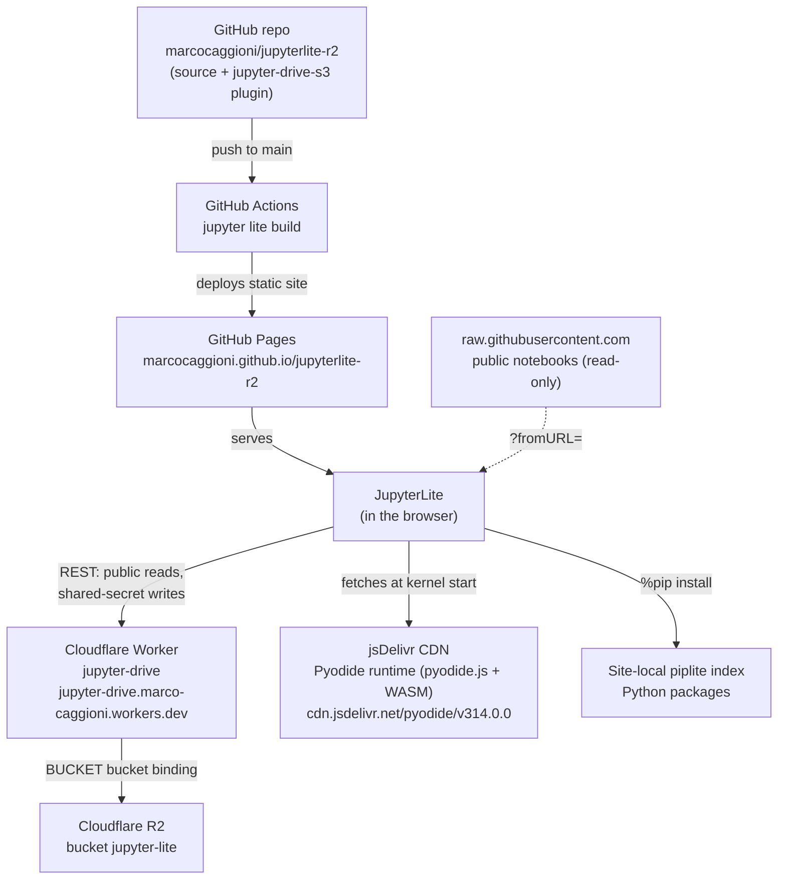

# JupyterLite with a shared R2 living drive

A [JupyterLite](https://jupyterlite.readthedocs.io/) site deployed to GitHub Pages:

➡️ **https://marcocaggioni.github.io/jupyterlite-r2**

It started from the [jupyterlite/demo](https://github.com/jupyterlite/demo)
template, but it is no longer a demo: the file browser is a living drive
backed by a Cloudflare R2 bucket, so notebooks and files live in shared
cloud storage instead of only in the browser.

## Architecture



How to read it: GitHub hosts the source and builds the static site;
GitHub Pages serves it; the running JupyterLite talks to the Cloudflare
Worker for the living drive, and the Worker is the only thing that talks
to the R2 bucket (via the `BUCKET` binding — no R2 keys ever reach a
browser). The Pyodide kernel runtime itself does not come from GitHub
Pages or Cloudflare: it is fetched at kernel start from the jsDelivr
CDN (`pyodideUrl` default of `jupyterlite-pyodide-kernel` 0.8.0; the
site does not override it), while `%pip install` packages come from the
site's own local piplite index. Frozen GitHub notebooks arrive via
`?fromURL=` from `raw.githubusercontent.com` and are never written back.

## The idea

A JupyterLite site with two ways to get content:

- **A living drive** — an R2-backed shared hard drive. Notebooks (already
  JSON), data files, images, PDFs, folders. Anything you save goes to the
  bucket, and any JupyterLite install with the drive plugin sees the same
  drive. Reading is public — no login, no keys. Saving goes through a
  Cloudflare Worker that holds the bucket keys and checks a shared secret,
  so no R2 credentials ever reach a browser.
- **Frozen content from GitHub** — open any public GitHub-hosted notebook
  read-only with `?fromURL=` (see below). Nothing is written back to
  GitHub.

Details, the implementation, and how to install the drive plugin in your
own JupyterLite: [docs/r2-drive.md](docs/r2-drive.md).

## Try it

Open <https://marcocaggioni.github.io/jupyterlite-r2> — the Drive Browser
on the left shows the bucket contents. Without the write secret the drive
is read-only; with the secret (Settings → Credentials Provider) saves go
to the bucket.

## Open a notebook from a GitHub URL

Append `?fromURL=` with a `raw.githubusercontent.com` link to open any
public GitHub-hosted notebook (read-only copy in browser storage):

```
https://marcocaggioni.github.io/jupyterlite-r2/lab?fromURL=https://raw.githubusercontent.com/<user>/<repo>/<branch>/<path>.ipynb
```

Multiple `fromURL` values open multiple files; `fromURLToFolder=<folder>`
places them in a folder.

## How this site deploys

Push to `main` and the GitHub Action in `.github/workflows/deploy.yml`
builds the site (`pip install -r requirements.txt`, then
`jupyter lite build --contents content --output-dir dist`) and deploys it
to GitHub Pages. Pull requests build only. Local build:

```bash
pip install -r requirements.txt
jupyter lite build --contents content --output-dir dist
```

No secret keys are stored in this repo, ever. The R2 API token is not
needed by the Worker route at all (see [docs/r2-drive.md](docs/r2-drive.md)).

## Requirements

JupyterLite is tested against modern web browsers: Firefox 90+,
Chromium 89+. The site ships the Pyodide kernel
(`jupyterlite-pyodide-kernel`), the JavaScript kernel
(`jupyterlite-javascript-kernel`), and the p5 kernel
(`jupyterlite-p5-kernel`); see
[`requirements.txt`](requirements.txt) for the full dependency list.

For the upstream JupyterLite docs:

- How-to Guides: https://jupyterlite.readthedocs.io/en/latest/howto/index.html
- Reference: https://jupyterlite.readthedocs.io/en/latest/reference/index.html
